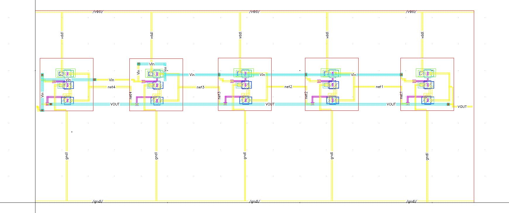
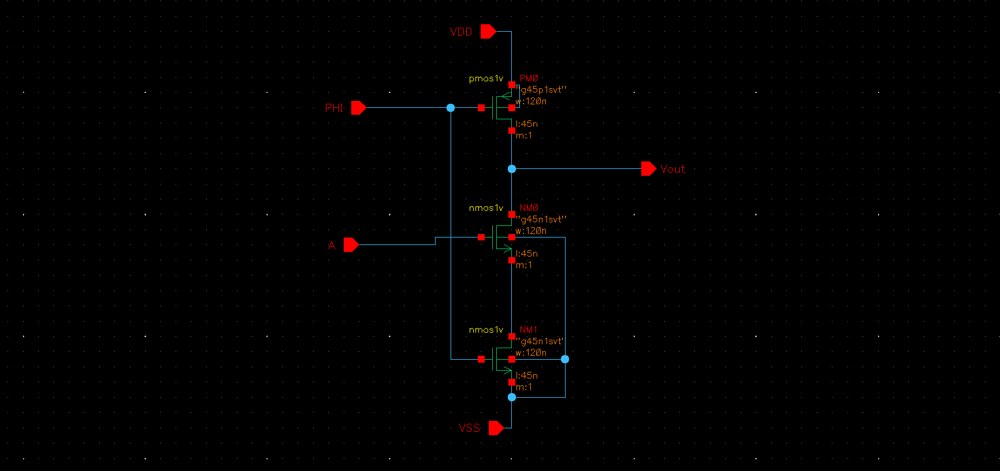
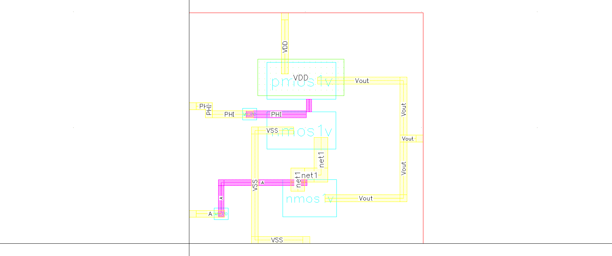

# 5-Stage Ring Oscillator Using Dynamic Logic


## 📌 Project Overview

This project focuses on the design and implementation of a **5-Stage Ring Oscillator Using Dynamic CMOS Logic**.

A ring oscillator is a circuit consisting of an odd number of inverter stages connected in a closed loop. It generates a continuous oscillating output without requiring an external periodic input signal.

This project explores dynamic CMOS logic for high-speed VLSI circuit design and its potential applications in next-generation 5G communication systems.

## 🎯 Objectives

- Design a 5-stage ring oscillator using CMOS logic.
- Understand dynamic CMOS logic operation.
- Design and implement the circuit schematic.
- Develop the physical layout of the circuit.
- Study oscillation behavior and frequency characteristics.
- Explore high-speed VLSI circuit design.

## ⚙️ Working Principle

1. Five inverter stages are connected in a closed-loop configuration.
2. Each stage introduces propagation delay.
3. The odd number of inverter stages creates the phase condition required for oscillation.
4. The output continuously switches between HIGH and LOW.
5. The oscillation frequency depends on the number of stages and propagation delay.

## 🧰 Tools and Technologies

- Cadence Virtuoso
- CMOS Technology
- Dynamic CMOS Logic
- VLSI Design
- Schematic Design
- Physical Layout Design

## 🔬 Circuit Design and Implementation

### 1. Five-Stage Ring Oscillator Schematic

The schematic shows five inverter stages connected in a ring configuration to generate an oscillating output signal.


### 2. Five-Stage Ring Oscillator Layout

The physical layout represents the implementation of the five-stage ring oscillator with VDD, GND, input and output connections.



### 3. Dynamic CMOS Circuit Schematic

The dynamic CMOS circuit schematic shows the transistor-level implementation using PMOS and NMOS transistors with clock and input connections.



### 4. Dynamic CMOS Layout

The layout represents the physical implementation of the dynamic CMOS circuit, showing transistor regions, metal interconnections and supply connections.



### 5.Simulation Results


## 📂 Project Structure
```text
5G-Ring-Oscillator-Using-Dynamic-logic/
│
├── 5stageringgcmosdy.png
├── 5stageringoscDYcmos.png
├── 5str_lay.png
├── 5str_sch_tb.png
├── 5stringosc.png
├── cmosDy_lay.png
├── cmosDy_sche.png
├── cmosDy_sym.png
├── cmosDynamic.zip
└── README.md
```

## 👩‍💻 Author

**K. Baby Navya**

Electronics and Communication Engineering (ECE)

## ⭐ Conclusion

This project demonstrates the design and implementation of a five-stage ring oscillator using dynamic CMOS logic. The schematic and physical layout provide practical understanding of transistor-level circuit design and VLSI implementation for high-speed applications.

---
If you find this project useful, don't forget to ⭐ the repository!


